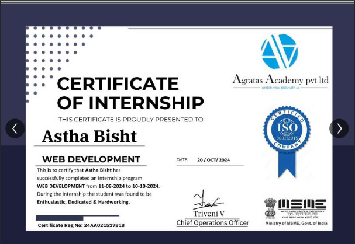
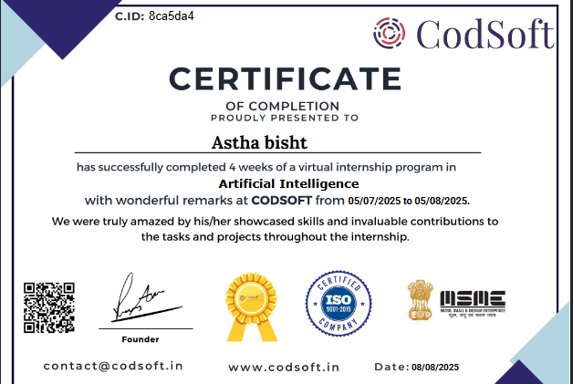

# ✨ Hey there, I'm Astha Bisht! 🌷

<div align="center">


<br/>

<a href="https://github.com/Asthabisht299">
  
</a>
<a href="https://www.linkedin.com/in/astha-bisht-s291105">
  
</a>
<a href="mailto:bishtaastha123@gmail.com">
  
</a>

</div>

---

## 🌸 A Little About Me

```javascript
const astha = {
    education: "B.Tech CSE | Uttaranchal Institute of Technology",
    graduation: 2027,
    role: "Full-Stack Web Development Enthusiast",
    strengths: ["Frontend Development", "Responsive UI", "Component-Based Design"],
    backend: ["REST API Fundamentals", "Database Integration", "Server-Side Basics"],
    currentlyExploring: ["Full-Stack Applications", "Better UI/UX", "Problem Solving"],
    mindset: "Build. Learn. Improve. Repeat. ✨"
};
```

I enjoy building responsive, user-friendly web experiences and turning ideas into practical applications. My main strength is frontend development, and I'm expanding my backend and database skills to build more complete, end-to-end applications.

I believe in writing cleaner code, learning through projects, and making technology useful for real people. 🌷

---

## 🛠️ My Tech Universe

### 🎨 Frontend

<p>
  
</p>

### ⚙️ Backend & Databases

<p>
  
</p>

### 💻 Languages & Tools

<p>
  
</p>

---

---

## 🚀 Projects I've Built

<p align="center">
  <i>୨୧ A little collection of ideas I've been turning into reality. ♡</i>
</p>

<table>
<tr>
<td width="50%" valign="top">

<h3 align="center">📚 Learning Management System</h3>

<p align="center">
  
  
  
</p>

<p align="center">
  A student-friendly learning platform designed to bring courses, learning progress, and educational resources together in one place.
</p>

**Highlights**
- 📖 Course and learning interface
- 📊 Student progress overview
- 🎨 Responsive UI with reusable components

<p align="center">
  <a href="https://github.com/Asthabisht299/Nexora-LMS">
    
  </a>
</p>

</td>
<td width="50%" valign="top">

<h3 align="center">🌷 Personal Portfolio</h3>

<p align="center">
  
  
  
</p>

<p align="center">
  A personal website showcasing my developer journey, technical skills, projects, and ways to connect with me.
</p>

**Highlights**
- ✨ Clean and responsive design
- 💻 Skills and project showcase
- 💌 Contact and social links

<p align="center">
  <a href="https://github.com/Asthabisht299?tab=repositories">
    
  </a>
</p>

</td>
</tr>
<tr>
<td colspan="2" valign="top">

<h3 align="center">🌾 KisanSetu — Smart Farmer Platform</h3>

<p align="center">
  
  
  
  
</p>

<p align="center">
  A farmer-focused procurement platform concept designed to simplify appointment booking, procurement-centre coordination, and status tracking.
</p>

<p align="center">
  🌱 Slot Booking &nbsp; • &nbsp; 📍 Centre Information &nbsp; • &nbsp; 📋 Status Tracking
</p>

<p align="center">
  <a href="https://github.com/Asthabisht299?tab=repositories">
    
  </a>
</p>

</td>
</tr>
</table>

<p align="center">
  <i>✧ Building, experimenting, and learning one project at a time. 🌸</i>
</p>

---

## 💼 Experience & Certifications

**Web Development Intern — Agratas Academy**  
*August 2024 – October 2024*

- Practiced HTML, CSS, and JavaScript.
- Built responsive layouts using Flexbox and CSS Grid.
- Learned mobile-first design and cross-browser development practices.


## 🎀 Certificates & Little Wins

<p align="center">
  <i>A little collection of things I've learned, built, and grown through. 🌷</i>
</p>

<div align="center">

<table>
<tr>
<td align="center" width="50%">

### 💻 Web Development

<a href="certificates/agratas-web-development.pdf">

</a>

**Agratas Academy** 🌸

<sub>August – October 2024</sub>

<br/>

<a href="certificates/agratas-web-development.pdf">

</a>

</td>
<td align="center" width="50%">

### 🤖 Artificial Intelligence

<a href="certificates/codsoft-ai.pdf">

</a>

**CodSoft** ✨

<sub>Artificial Intelligence Internship</sub>

<br/>

<a href="certificates/codsoft-ai.pdf">

</a>

</td>
</tr>
</table>

<br/>

*୨୧ Every certificate is a reminder that progress happens one step at a time. ♡*

</div>


## 📊 GitHub Corner

<div align="center">


</div>

---

## 🌱 What I'm Growing Into

- Building more complete full-stack web applications.
- Strengthening backend development and database integration.
- Improving problem-solving and data structures.
- Creating responsive, accessible, and intuitive user interfaces.
- Collaborating on meaningful projects and learning from other developers.

---

## 🎀 Developer Lore

```text
╭────────────────────────────────────╮
│  Current status: Always learning 🌱 │
│  Favourite activity: Building 💻   │
│  Superpower: Turning ideas into UI │
│  Weakness: One more CSS adjustment │
│  Mission: Create things that matter│
╰────────────────────────────────────╯
```

*Somewhere between a good idea and a working application, you'll find me debugging. ☕*

---

## 💌 Get in Touch

<div align="center">

<a href="https://www.linkedin.com/in/astha-bisht-s291105">
  
</a>
<a href="mailto:bishtaastha123@gmail.com">
  
</a>
<a href="https://github.com/Asthabisht299">
  
</a>
<a href="https://leetcode.com/u/Astha_299/">
  
</a>

<br/><br/>

*♡ Open to collaborations, creative projects, and opportunities to build something meaningful.*

### ✨ Thanks for stopping by! ✨


</div>
